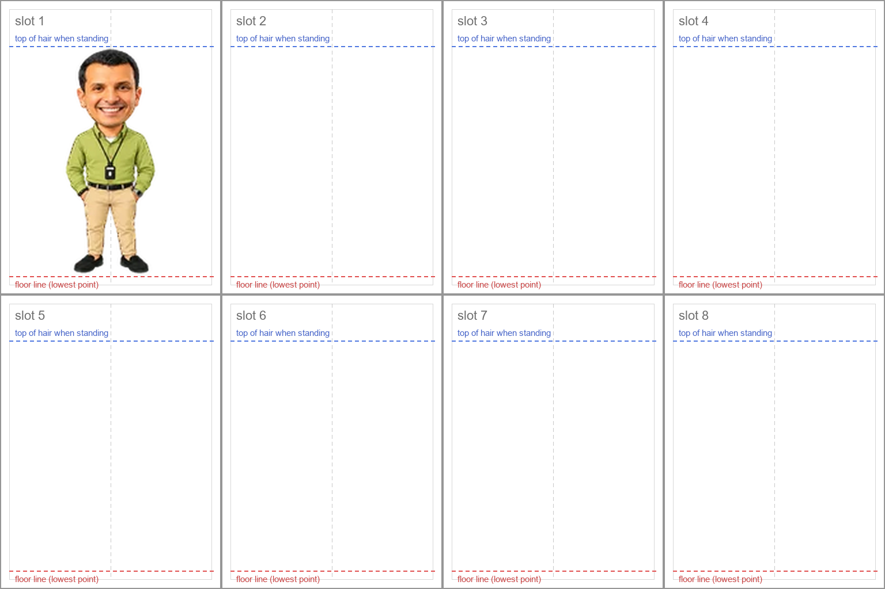

# Amr: art brief for the interactive pet

This brief is for **OpenAI image generation** (the Image 2.5 model, in ChatGPT or through the API). It asks for 10 new sprite sheets of Amr. They let the pet react to touch, the mouse, phone tilt and shake, scrolling, typing, idle time and the chat agent, on both desktop and mobile.

The brief has three readers:

| Part                                                                                                         | Who reads it                              |
| ------------------------------------------------------------------------------------------------------------ | ----------------------------------------- |
| [0. How to run it](#0-how-to-run-it)                                                                         | You                                       |
| [2. Master block](#2-master-block) and the [sheets](#4-the-sheets)                                           | The image model (paste them in)           |
| [Appendix A](#appendix-a--interaction-map-for-the-code) and [B](#appendix-b--engineering-notes-for-the-code) | Claude, when wiring the art into the site |

Each sheet is one image of 8 poses. The site slices it, lines it up with the current sprite sheet (`public/mascot/amr.7d281181.webp`, 192×208 cells) and plays it.

---

## 0. How to run it

**Settings for every image**

- Size **1536 × 1024** (landscape), **transparent background**, **PNG**, **high** quality, one image per request.
- API users: `size: "1536x1024"`, `background: "transparent"`, `output_format: "png"`, `quality: "high"`, and `input_fidelity: "high"` if your model accepts it, because it keeps the face closer to the references. Drop any parameter your model rejects.

**Attach these references to every request** (they are in [`reference/`](reference/)):

| File                                             | What it is                                                                    |
| ------------------------------------------------ | ----------------------------------------------------------------------------- |
| [`ref-1-stance.png`](reference/ref-1-stance.png) | His standard stance from the live site: the starting pose of every sheet      |
| [`ref-hair.png`](reference/ref-hair.png)         | His haircut from the live site, from the front, turned, looking up and down   |
| [`ref-2-detail.png`](reference/ref-2-detail.png) | High-resolution detail of face, fabric, lanyard, watch and band. Not his hair |
| [`ref-3-range.png`](reference/ref-3-range.png)   | Eight poses he already has, including side and turned views                   |
| Your approved S01 sheet                          | After S01 passes the checklist, attach it as a fifth reference for the rest   |

The hair in `ref-2-detail.png` is curly and is not his. The first round copied it, so his hair is now described from the live sprite and shown in `ref-hair.png`. To fix sheets that already have the curly hair, use [the hair edits](AMR-HAIR-EDITS.md).

[`layout-guide.png`](reference/layout-guide.png) shows the slot grid, the floor line and the stance at the right size. It is for you. Attach it only if the model keeps getting the layout wrong, and then add "the lines and labels in the layout guide are guides only — do not draw them".

**Each request = the [Master block](#2-master-block) + one sheet block from [section 4](#4-the-sheets).** Paste both into the same message.

**Order:** S01 first, because it fixes his face and scale for everything after it. Then follow the priority order in [section 1](#1-the-sheets-at-a-glance). Doing every sheet in one ChatGPT conversation helps keep him consistent. If he starts to drift (a different face, a bigger head, a lost lanyard), start a new conversation with the references and the approved S01 attached.

**If the transparent background fails**, add this as the last line of your message: _"Change to the background: instead of transparency, use one flat, solid magenta colour (#FF00FF) everywhere outside the character, with no gradient, no shadow and no texture."_ Never use green (his shirt is green) or white (his T-shirt collar is white). The slicer keys magenta out.

**Fixing one bad slot:** ask for an edit of the same image: _"Keep slots 1–7 exactly as they are. Redraw only slot 8: …"_. If more than two slots are wrong, regenerate the whole sheet.

**Run every sheet through the [checklist](#5-check-every-sheet-before-you-keep-it)** before you keep it. Save the keepers with the file names in section 1 (`S01-faces.png` and so on), then send them back as described in [section 6](#6-hand-back).

---

## 1. The sheets at a glance

| Order | Sheet | File name            | What it unlocks                                                   | Priority  |
| ----- | ----- | -------------------- | ----------------------------------------------------------------- | --------- |
| 1     | S01   | `S01-faces.png`      | Talking mouth (lip-sync with chat) and four expressions           | Must have |
| 2     | S04   | `S04-touch.png`      | Poke, giggle, tickle, head pat, bashful (mobile touch)            | Must have |
| 3     | S05   | `S05-lifted.png`     | Picked up and dangling while dragged, swinging, flailing, landing | Must have |
| 4     | S02   | `S02-explaining.png` | Hand gestures while he talks                                      | Must have |
| 5     | S06   | `S06-balance.png`    | Phone tilt (balancing) and phone shake (dizzy)                    | Sensors   |
| 6     | S07   | `S07-rest.png`       | Yawn, stretch, sit, doze, startled awake (idle time, late night)  | Sensors   |
| 7     | S08   | `S08-page.png`       | Fast scroll (wind), visitor typing, success, clapping, offline    | Sensors   |
| 8     | S03   | `S03-pointing.png`   | Points in 7 directions to guide visitors to things on the page    | Guide     |
| 9     | S09   | `S09-social.png`     | High five (long-press), peekaboo, "you've got this", bow on Hide  | Social    |
| 10    | S10   | `S10-stroll.png`     | A short walk along the bottom of the screen (desktop)             | Optional  |

Slot 1 of every sheet is his standard stance. It is the start and end of every action, and the slicer uses it to measure his size on that sheet.

---

## 2. Master block

Paste this at the top of every request, unchanged.

```text
You are drawing animation frames of "Amr", a small animated companion who lives in the corner of a website. The attached references show the exact character: ref-1 is his standard stance, ref-hair is his haircut from several angles, ref-2 is high-resolution detail of his face, shirt fabric, lanyard, watch and fitness band (ignore the book, the pose and the hair in ref-2), ref-3 shows poses he already has, and ref-4 (when attached) is an approved sheet you must match. Reproduce him exactly. Do not redesign him.

CHARACTER (identical in every slot)
- Amr is a friendly Egyptian man. His default expression is a warm, open smile showing his upper teeth.
- Short, close-cropped, near-black hair exactly as in ref-hair: it follows the shape of his head, with only a little height at the front, brushed slightly up and back; a fine, smooth texture with a soft sheen, with no curls, no waves and no puffy volume; short tapered sides with his ears fully visible. The same haircut in every slot. Take his hair only from ref-hair and ref-1, never from ref-2.
- Dark eyebrows, clean-shaven, warm tan skin.
- Caricature figurine proportions: big head, small slim body. His head (top of hair to chin) is exactly the size it is in ref-1, a little under one third of his standing height. Do not make it bigger. The head is the same size in every slot.
- Lime-olive green long-sleeve button-up shirt (about #A8B54F), tucked in. Open collar with a white crew-neck T-shirt showing at the neck. The sleeves are always full length down to buttoned cuffs at the wrists. Never rolled up.
- A long, thin black lanyard: from the back of his neck it forms a long V down his chest to a black ID badge holder (an upright rectangle with a small white window) hanging a little below mid-chest. It hangs and swings with gravity but never disappears.
- Black leather belt with a silver rectangular buckle. Khaki chino trousers (about #DDB985). Black slip-on loafers.
- A black fitness band on his RIGHT wrist and a silver wristwatch with a dark dial on his LEFT wrist. When he faces us, the black band is on the viewer's LEFT and the silver watch is on the viewer's RIGHT. Keep them on those wrists in every pose. Never mirror or flip the character to make a pose; draw every direction for real.
- Natural hands with five fingers, clearly separate from each other and from the body.

STYLE
- A polished 3D caricature figurine render exactly like the references: soft, even studio light from the front and slightly above, gentle shading, natural skin, matte fabric, a crisp clean silhouette. No outlines, no cel shading, no pixel art, no painterly brush strokes, no anime.
- He will be shown very small on screen (about 100 to 130 pixels tall). Every pose must read clearly as a silhouette: clear arm and body positions, natural but slightly exaggerated acting.

SHEET LAYOUT
- One image, 1536 x 1024 pixels, landscape, with a fully transparent background.
- An invisible grid of 4 columns x 2 rows = 8 equal slots, each 384 pixels wide and 512 pixels tall. Slots are numbered left to right: top row 1, 2, 3, 4; bottom row 5, 6, 7, 8.
- Exactly one full-body Amr in each slot, centred horizontally in his slot. Nothing touches or crosses a slot edge; keep at least 16 pixels clear on every side.
- The same scale in all 8 slots. Standing straight he is about 400 pixels tall: the top of his hair is about 80 pixels below the top of the slot, and his soles rest on an invisible floor line 32 pixels above the bottom of the slot.
- Draw every pose in place. The lowest point of his body (his feet, or his seat when sitting) always rests on that floor line, even when the pose is a hop, a dangle or a stumble. The website moves him around; the art only changes the pose.
- When his arms are raised, his hands stay within one third of a head-height above the top of his hair.
- The camera faces him at chest height unless a slot says otherwise.

NEVER
- No background, floor, ground shadow, vignette or glow. Transparent background only.
- No text, numbers, labels, captions, logos, signatures, grid lines, borders or slot frames.
- No motion lines, speech bubbles, hearts, stars, "Zzz", sweat drops, sparkles or other effects. The website adds those.
- No props unless a slot asks for one. No other characters.
- No cropped or cut-off body parts. No extra, missing or merged fingers.
```

---

## 3. What the layout looks like



The red line is the floor: his lowest point always sits on it. The blue line is the top of his hair when he stands. Slot 1 shows the stance at the correct size.

---

## 4. The sheets

Each sheet has a block to paste after the Master block, and a table that says what the code does with each slot. The table is for the code. Don't paste it, or its labels may end up drawn in the image.

### S01 — Faces

The code swaps only his head between these slots, so he can talk and change expression in any front-facing pose. That is why the body must not change at all.

```text
SHEET S01 — FACES.
All 8 slots show the SAME standard stance as ref-1: standing straight, facing us, both hands in his trouser pockets, feet slightly apart. His body, clothes, lanyard, hands, feet, head size and head position are identical in all 8 slots, and his head stays upright and facing us. ONLY THE FACE CHANGES.
1. His default face: the warm smile showing his upper teeth, exactly as in ref-1.
2. Talking: lips closed in a gentle smile.
3. Talking: mouth slightly open and relaxed, as in the middle of a word.
4. Talking: mouth open wide as if saying "ah", eyebrows slightly raised.
5. Happy: eyes closed in upward crescents, big smile, cheeks raised.
6. Surprised: eyebrows high, eyes wide open, mouth a small round "o".
7. Sleepy: heavy, half-closed eyelids, a small relaxed smile.
8. Concerned and apologetic: eyebrows raised in the middle, a small sympathetic smile with lips closed.
```

| Slot | Frame ID           | Code use                                       |
| ---- | ------------------ | ---------------------------------------------- |
| 1    | `face.default`     | Calibration; talking rest frame                |
| 2    | `face.talk-closed` | Lip-sync while a chat reply streams            |
| 3    | `face.talk-small`  | Lip-sync                                       |
| 4    | `face.talk-wide`   | Lip-sync, stressed syllables                   |
| 5    | `face.happy`       | Head pat, compliments, positive chat sentiment |
| 6    | `face.surprised`   | Startle, fast pointer pass, phone rotated      |
| 7    | `face.sleepy`      | Long idle, before he sits down; late at night  |
| 8    | `face.concerned`   | Agent errors, offline, rate limit reached      |

### S02 — Explaining

```text
SHEET S02 — EXPLAINING. Amr is talking to us and using his hands. In every slot his head stays upright and facing us, with his default smile.
1. The standard stance, exactly as in ref-1.
2. Hands out of his pockets, arms relaxed at his sides, ready to talk.
3. His right hand (on the viewer's left, with the black band) raised to chest height, palm open and turned up, explaining. Other arm relaxed.
4. Both hands open in front of his waist, palms up, as if saying "here's the idea".
5. His left hand (on the viewer's right, with the silver watch) raised with the index finger pointing up, making one important point. Other arm relaxed.
6. The fingertips of both hands touching in front of his chest, thoughtful.
7. Both arms open wide at waist height, palms forward, welcoming.
8. A friendly shrug: shoulders up, both palms up at waist height, eyebrows raised.
```

| Slot | Frame ID         | Code use                                                         |
| ---- | ---------------- | ---------------------------------------------------------------- |
| 1    | `explain.stance` | Calibration                                                      |
| 2–7  | `explain.1`–`6`  | Gesture loop while talking; S01 mouths are swapped onto the head |
| 8    | `explain.shrug`  | "I don't know", no search results, can't do that                 |

### S03 — Pointing

```text
SHEET S03 — POINTING. Amr points with one fully extended arm and index finger, and his head and eyes turn to look where he points. The other hand stays in his pocket.
1. The standard stance, exactly as in ref-1.
2. Pointing to the viewer's left, arm horizontal, using his right arm (black band).
3. Pointing up and to the viewer's left at 45 degrees, using his right arm (black band).
4. Pointing straight up with his right arm (black band), looking up.
5. Pointing up and to the viewer's right at 45 degrees, using his left arm (silver watch).
6. Pointing to the viewer's right, arm horizontal, using his left arm (silver watch).
7. Pointing down and to the viewer's left at 45 degrees, using his right arm (black band), looking down there.
8. Pointing down and to the viewer's right at 45 degrees, using his left arm (silver watch), looking down there.
```

| Slot | Frame ID                                                                        | Code use                                                                                                                                          |
| ---- | ------------------------------------------------------------------------------- | ------------------------------------------------------------------------------------------------------------------------------------------------- |
| 1    | `point.stance`                                                                  | Calibration                                                                                                                                       |
| 2–8  | `point.l`, `point.ul`, `point.u`, `point.ur`, `point.r`, `point.dl`, `point.dr` | Visitor guide and tours point at the highlighted element from whatever corner he's parked in; `point.u` offers "back to top" at the end of a page |

### S04 — Touch

```text
SHEET S04 — TOUCH. Amr reacts to being touched by the visitor's finger. Draw no finger or hand touching him; only his reaction.
1. The standard stance, exactly as in ref-1.
2. Poked in the tummy: hips pulled back, upper body leaning forward a little, hands out of his pockets and up near his chest, eyes wide, laughing in surprise.
3. Giggling: one hand covering his mouth, eyes squeezed shut with laughter, shoulders raised.
4. Being tickled: squirming toward the viewer's left, elbows clamped to his sides, knees bent inward, laughing with his mouth open and eyes closed.
5. Being tickled: the same idea, squirming toward the viewer's right.
6. Enjoying a head pat: head tilted toward the viewer's left, eyes closed happily, shoulders slightly raised, content smile, hands in pockets.
7. Enjoying a head pat: the same, head tilted toward the viewer's right.
8. Bashful: one hand rubbing the back of his head, a shy smile, looking slightly down, other hand in his pocket.
```

| Slot | Frame ID                     | Code use                                               |
| ---- | ---------------------------- | ------------------------------------------------------ |
| 1    | `touch.stance`               | Calibration                                            |
| 2, 3 | `touch.poke`, `touch.giggle` | A tap on his body: 2 → 3 → stance                      |
| 4, 5 | `touch.tickle-l`, `-r`       | Rapid taps or rubbing on his body: 4 ↔ 5               |
| 6, 7 | `touch.pat-l`, `-r`          | Stroking across his head: follows the stroke direction |
| 8    | `touch.bashful`              | Mouse resting on him (desktop), after a compliment     |

### S05 — Picked up and landing

```text
SHEET S05 — PICKED UP. The visitor picks Amr up and drops him. Draw no hand holding him.
1. The standard stance, exactly as in ref-1.
2. Lifted: hanging as if picked up by the back of his collar, shoulders raised toward his ears, body straight and relaxed, legs hanging down with toes pointing down, arms a little away from his body, amused smile.
3. Swinging: the same lifted pose with his legs and hips swung toward the viewer's left and his arms trailing, playful.
4. Swinging: the same lifted pose with his legs swung toward the viewer's right.
5. Flailing: alarmed face, arms waving, legs kicking as if running in the air.
6. Landing: a deep crouch just after touching down, knees bent, arms out to the sides for balance.
7. Recovering: almost upright, arms still out, slightly off balance, relieved smile.
8. Straightening up: tugging the hem of his shirt straight with both hands, looking down at himself, satisfied.
```

| Slot    | Frame ID                              | Code use                                                     |
| ------- | ------------------------------------- | ------------------------------------------------------------ |
| 1       | `lifted.stance`                       | Calibration                                                  |
| 2, 3, 4 | `lifted.hang`, `lifted.swing-l`, `-r` | While dragged: a pendulum driven by drag speed and direction |
| 5       | `lifted.flail`                        | Fast drag, or thrown                                         |
| 6, 7, 8 | `lifted.land`, `.recover`, `.tidy`    | Dropped: 6 → 7 → 8 → idle                                    |

### S06 — Balance and dizzy

```text
SHEET S06 — BALANCE AND DIZZY. The visitor tilts and shakes their phone, and Amr feels it.
1. The standard stance, exactly as in ref-1.
2. Balancing: his whole body tipping about 10 degrees toward the viewer's left with his feet still on the floor, arms stretched out to both sides for balance, worried grin.
3. Balancing: tipping about 10 degrees toward the viewer's right, arms out, worried grin. Draw this direction for real (black band still on his right wrist, watch on his left).
4. Losing his balance: arms windmilling, one foot lifted off the floor, a "whoa" face.
5. Steady again: exhaling with relief, one hand on his chest.
6. Dizzy: a wobbly stance, knees soft, head tilted, eyes unfocused and looking in slightly different directions, one hand on his forehead.
7. Dizzy, wobbling the other way: the same idea with the opposite tilt.
8. Shaking it off: eyes squeezed shut, head turned a little, shoulders up, shaking off the dizziness.
```

| Slot | Frame ID              | Code use                                              |
| ---- | --------------------- | ----------------------------------------------------- |
| 1    | `balance.stance`      | Calibration                                           |
| 2, 3 | `balance.tip-l`, `-r` | Phone tilted past about 15°, toward that side         |
| 4    | `balance.whoa`        | Tilted past about 35°, or a sudden jolt               |
| 5    | `balance.steady`      | Phone level again                                     |
| 6, 7 | `dizzy.a`, `dizzy.b`  | Phone shaken, or 7+ rapid clicks: 6 ↔ 7 for about 2 s |
| 8    | `dizzy.shake-off`     | Then back to idle                                     |

### S07 — Rest

```text
SHEET S07 — REST. Amr gets sleepy when nobody is around.
1. The standard stance, exactly as in ref-1.
2. A big yawn: one hand over his open mouth, eyes squeezed shut, other hand in his pocket.
3. A stretch: both arms raised above his head with elbows slightly bent (hands no more than one third of a head-height above his hair), up on his toes, yawning.
4. Sitting down: halfway down, knees bent, one hand reaching toward the floor.
5. Sitting cross-legged on the floor, relaxed, hands resting on his knees, looking at us with a calm smile.
6. Dozing while sitting cross-legged: head drooped forward, eyes closed, shoulders relaxed.
7. Dozing, breathing in: the same as slot 6 but with his head slightly raised and his chest slightly higher. A subtle difference, for a slow breathing loop.
8. Startled awake while still sitting: head snapped up, eyes wide, hands up by his shoulders.
```

| Slot | Frame ID                        | Code use                                               |
| ---- | ------------------------------- | ------------------------------------------------------ |
| 1    | `rest.stance`                   | Calibration                                            |
| 2, 3 | `rest.yawn`, `rest.stretch`     | Quiet for about 45 s; first visit of the morning       |
| 4, 5 | `rest.sit-down`, `rest.sitting` | Quiet for about 2 min (4 played backwards to stand up) |
| 6, 7 | `rest.doze-a`, `-b`             | Quiet for about 4 min: slow 6 ↔ 7, the code adds "Zzz" |
| 8    | `rest.startled`                 | Any input while dozing: 8 → 4 → stance                 |

### S08 — Page moments

```text
SHEET S08 — PAGE MOMENTS. Amr reacts to what the visitor is doing on the page.
1. The standard stance, exactly as in ref-1.
2. Bracing against a strong wind: leaning forward into it, one forearm raised to shield his eyes, his shirt and lanyard blown back, feet planted.
3. Bracing against the wind, alternate: the same as slot 2 with the lanyard and shirt fluttering in a different position and his head slightly lower, so 2 and 3 can loop.
4. Watching closely: leaning forward with his hands on his knees, looking up toward the viewer's left with eager interest.
5. A small victory: one fist pumped at chest height, eyes closed, delighted grin, other hand in his pocket.
6. Clapping, hands apart: both hands in front of his chest just before they meet, big smile.
7. Clapping, hands together: palms touching in front of his chest, big smile.
8. Downcast: shoulders slumped, arms hanging, looking down at the floor, a small sad mouth.
```

| Slot | Frame ID            | Code use                                     |
| ---- | ------------------- | -------------------------------------------- |
| 1    | `page.stance`       | Calibration                                  |
| 2, 3 | `page.wind-a`, `-b` | Fast scrolling: 2 ↔ 3 until the page settles |
| 4    | `page.watching`     | The visitor is typing in a field (desktop)   |
| 5    | `page.yes`          | A form sent, a tool finished, back online    |
| 6, 7 | `page.clap-a`, `-b` | Bigger wins: 6 ↔ 7                           |
| 8    | `page.downcast`     | Gone offline, an action failed               |

### S09 — Social

```text
SHEET S09 — SOCIAL.
1. The standard stance, exactly as in ref-1.
2. Offering a high five: his right hand (on the viewer's left, with the black band) raised beside his head, palm facing us, eager grin. Other hand in his pocket.
3. High five: the same palm pushed forward toward us, eyes squeezed shut, big grin.
4. After the high five: shaking that hand out, laughing.
5. Peekaboo, hiding: both hands covering his eyes, grinning.
6. Peekaboo, found you: hands open beside his face, eyes wide and delighted.
7. "You've got this": pointing his index finger straight at us, arm forward toward the camera, confident encouraging grin.
8. A polite bow: bowing from the waist about 30 degrees, one hand on his chest, eyes closed, smiling.
```

| Slot | Frame ID                                 | Code use                                               |
| ---- | ---------------------------------------- | ------------------------------------------------------ |
| 1    | `social.stance`                          | Calibration                                            |
| 2–4  | `social.hi5-offer`, `.hi5`, `.hi5-after` | Long-press on him: 2 while held, 3 → 4 on release      |
| 5, 6 | `social.peek-hide`, `.peek-found`        | Pointer leaves the window and comes back (desktop)     |
| 7    | `social.you`                             | Encouragement after a finished task, the end of a tour |
| 8    | `social.bow`                             | Hide: bow, then hide                                   |

### S10 — Stroll (optional)

The hardest sheet to get smooth. If it doesn't come out well, skip it: the site falls back to the running poses it already has.

```text
SHEET S10 — STROLL. A relaxed walk in a three-quarter view, like the running pose in ref-3, with his hands out of his pockets and arms swinging gently.
1. The standard stance, exactly as in ref-1.
2. Walking toward the viewer's right, body turned about 60 degrees toward the right: left foot forward with the heel down, right arm forward. His right side (black band) is the side nearer to us.
3. Walking toward the viewer's right: the passing position, legs together under his body, standing tall.
4. Walking toward the viewer's right: right foot forward with the heel down, left arm forward.
5. Walking toward the viewer's left, body turned about 60 degrees toward the left: right foot forward with the heel down, left arm forward. His left side (silver watch) is the side nearer to us.
6. Walking toward the viewer's left: the passing position.
7. Walking toward the viewer's left: left foot forward with the heel down, right arm forward.
8. Turning back to face us: halfway between the walking view and facing us.
```

| Slot    | Frame ID                 | Code use                                                        |
| ------- | ------------------------ | --------------------------------------------------------------- |
| 1       | `stroll.stance`          | Calibration                                                     |
| 2, 3, 4 | `stroll.r-1`, `-2`, `-3` | Walk right: 2 → 3 → 4 → 3, the code slides him along the bottom |
| 5, 6, 7 | `stroll.l-1`, `-2`, `-3` | Walk left: 5 → 6 → 7 → 6                                        |
| 8       | `stroll.turn`            | Between walking and the stance                                  |

---

## 5. Check every sheet before you keep it

Look at it on a dark background as well as a light one, then zoom out until he is about 120 pixels tall.

- [ ] Exactly 8 figures, one per slot, nothing touching a slot edge.
- [ ] Transparent background (no white or grey box, no ground shadow).
- [ ] The same head size and the same scale in all 8 slots.
- [ ] Every figure's lowest point is on the same floor line.
- [ ] It is clearly Amr: compare the face with `ref-2-detail.png`.
- [ ] His hair is the short, smooth haircut of `ref-hair.png` in all 8 slots: no curls, ears visible, the same in every slot.
- [ ] Black band on his right wrist, silver watch on his left (viewer's left and right when he faces us).
- [ ] Full-length sleeves with cuffs, lanyard and badge, belt and buckle, khaki trousers, black loafers.
- [ ] Hands have five fingers; none are merged with each other or with his body.
- [ ] No text, numbers, lines, borders, effects, extra props or other characters.
- [ ] **S01 only:** the body is the same in all 8 slots and only the face changes.
- [ ] Zoomed out to about 120 px tall, you can still tell what every pose means.

---

## 6. Hand back

Send the keepers back to Claude the same way as the companion kit (a zip), or put them in one folder and share its path. Use the file names from section 1, for example `S01-faces.png`. A partial set is fine: S01, S04 and S05 alone already give the biggest change.

Claude will then:

1. Slice each sheet and line every frame up with the current sprite sheet (same height, same floor line).
2. Clean the edges and build 1× (192×208) cells and sharper 2× cells for phones and high-resolution screens.
3. Pack them into small WebP sheets that load only when needed, next to the current sheet.
4. Build a review page that plays every animation at real size on light and dark backgrounds, for your approval.
5. Wire up the interactions in Appendix A, then test on desktop and mobile.

---

## Appendix A — interaction map (for the code)

Not for the image model. This is how each input becomes a reaction. Existing rows (idle, running, wave, jump, failed, waiting, thinking, review and the 16 look poses) stay as they are.

| Input                                 | Detected by                                                 | Desktop | Mobile | Plays                                                      |
| ------------------------------------- | ----------------------------------------------------------- | ------- | ------ | ---------------------------------------------------------- |
| Chat reply streaming                  | `useMascotStore.talking`, text chunk rhythm                 | ✓       | ✓      | S02 gesture loop + S01 mouths swapped onto the head        |
| Agent error / rate limit              | chat and tool bridge                                        | ✓       | ✓      | S01 concerned, S02 shrug or S08 downcast                   |
| Tool finished, form sent              | chat and tool bridge, `submit`                              | ✓       | ✓      | S08 small victory; bigger wins clap                        |
| Tap on his body                       | pointer up with little movement, on the body hit zone       | ✓       | ✓      | S04 poke → giggle                                          |
| Rapid taps or rubbing on his body     | 3+ taps in 1 s, or back-and-forth pointer movement over him | ✓       | ✓      | S04 tickle loop                                            |
| Stroke across his head                | pointer moving sideways across the head zone                | ✓       | ✓      | S04 head pat, following the stroke                         |
| Mouse resting on him                  | hover dwell of 1.2 s, fine pointer only                     | ✓       |        | S04 bashful                                                |
| Long-press                            | press of 500 ms or more with little movement                | ✓       | ✓      | S09 high five                                              |
| Drag                                  | the existing drag-to-reposition                             | ✓       | ✓      | S05 dangle and swing (replaces running while dragged)      |
| Throw                                 | release speed above a threshold                             | ✓       | ✓      | S05 flail in a short arc, then landing                     |
| Dropped                               | drag end                                                    | ✓       | ✓      | S05 land → recover → tidy                                  |
| Mouse position                        | the existing look tracking                                  | ✓       |        | Existing 16 look poses                                     |
| Fast pass close by                    | pointer speed near him                                      | ✓       |        | S01 surprised                                              |
| 7+ rapid clicks                       | existing click escalation                                   | ✓       | ✓      | S06 dizzy                                                  |
| Phone tilt                            | `deviceorientation` gamma                                   |         | ✓      | S06 tip left or right; past 35° whoa; level again steady   |
| Phone shake                           | `devicemotion` acceleration spikes, 3 within 1 s            |         | ✓      | S06 dizzy → shake it off                                   |
| Phone rotated                         | `orientationchange` / screen orientation                    |         | ✓      | S01 surprised, then a look around                          |
| Fast scroll                           | scroll speed above about 2,500 px/s                         | ✓       | ✓      | S08 wind loop until scrolling stops                        |
| End of the page                       | scrolled to the bottom                                      | ✓       | ✓      | S03 point up, offering "back to top"                       |
| Visitor typing                        | `focusin` and `input` on fields                             | ✓       |        | S08 watching (phones already step aside for the keyboard)  |
| Copied text                           | `copy` event                                                | ✓       | ✓      | Existing thumbs-up                                         |
| Offline / back online                 | `offline` / `online` events                                 | ✓       | ✓      | S08 downcast / S08 small victory                           |
| Back after a while                    | `visibilitychange`, away more than 2 minutes                | ✓       | ✓      | Existing wave                                              |
| Pointer leaves the window and returns | `mouseout` to outside the window, then back                 | ✓       |        | S09 peekaboo                                               |
| Nobody around                         | no input for 45 s / 2 min / 4 min                           | ✓       | ✓      | S07 yawn → sit → doze; any input → startled → stand        |
| Time of day                           | local clock                                                 | ✓       | ✓      | Morning stretch on the first visit; more yawns after 23:00 |
| Guide or tour step                    | `visitor-guide.tsx`                                         | ✓       | ✓      | S03 pointing toward the target, from his corner            |
| Hide / Restore                        | the mascot menu                                             | ✓       | ✓      | S09 bow, then hide / existing wave                         |
| Long idle on desktop                  | no input for 20–60 s, panel closed                          | ✓       |        | S10 a few steps along the bottom and back (optional)       |

**Rules that apply to all of these**

- **Privacy:** no camera and no microphone (the existing voice input stays as it is). Sensor readings never leave the device.
- **iOS motion permission:** iOS only gives motion data after a tap on `DeviceMotionEvent.requestPermission()`. Add a "Let Amr feel your phone" switch in his menu. On Android it works without a prompt.
- **Reduced motion** (`prefers-reduced-motion`): one still per state, with no dangling, throwing, strolling or sensor reactions.
- **Battery and data:** pause everything while the tab is hidden; on Save-Data, skip the optional packs.
- **Restraint:** a cooldown for each reaction, never the same reaction twice in a row, and at most one unprompted reaction every 20 s.

---

## Appendix B — engineering notes (for the code)

- **Registration.** For each sheet, take the scale from slot 1 so his stance is 181 native px tall, the same as rows 23–204 of idle frame 0 in the current 192×208 cell. Put the floor line at row 204 and centre each frame on its lower body, not its bounding box (an outstretched arm would shift it).
- **In place.** The art never moves him. Hops, throw arcs, the dangle sway and the stroll's travel are done in code, as the springs in `engine/procedural-anim.ts` already do.
- **Head swaps.** S01 and S02 keep the head upright and frontal so the S01 heads (rows above the collar, about native row 86) can be swapped onto S02 gestures and onto idle, with a feathered seam. Lip-sync cycles `face.talk-*` with the rhythm of the streamed text.
- **No mirroring.** The band and watch would swap wrists, so every left and right pose is drawn separately.
- **Lazy packs.** The current sheet stays the boot sheet. S01, S02, S04 and S05 load on the first interaction; the sensor packs load on their first event; S10 loads only on desktop.
- **Identity.** The companion kit's rig contract allows his head only from the pinned original atlas. These generated heads break that rule. If the side-by-side review shows any drift, a strict mode can paste the original idle head onto the upright, front-facing frames (S01 and S02), at the cost of the S01 expressions.
